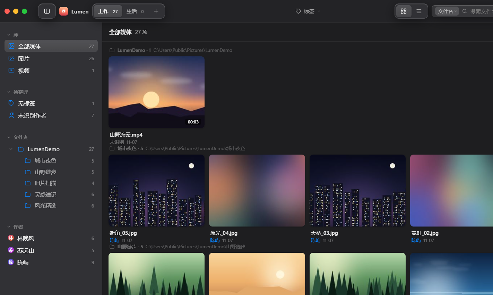

# Lumen

**A lightweight, fully local photo & video library for Windows.**
No account. No cloud. No upload. Your files are never moved.

轻量的 Windows 本地图片 / 视频管理工具。扫描进来的照片和视频，按文件夹 / 日期 / 作者 /
类型分组，打标签、搜索、双击就能在应用里看片。**不联网、不上传、不复制原片**，
卸载即清空。




---

## 目录

- [为什么会有这个项目](#为什么会有这个项目)
- [亮点](#亮点)
- [功能清单](#功能清单)
- [快捷键](#快捷键)
- [安装](#安装)
- [数据与隐私](#数据与隐私)
- [它是怎么工作的](#它是怎么工作的)
- [常见问题](#常见问题)
- [从源码构建](#从源码构建)
- [贡献](#贡献)

---

## 为什么会有这个项目

系统自带的照片应用会往云端同步，第三方图库要么订阅制、要么把你的库导入它自己的私有格式、
要么为了「智能分类」偷偷上传缩略图。而实际需求往往很朴素：

> 我有几十万张散在几个硬盘里的图和视频，只想**在本机**把它们看明白、分好类、能搜到。

Lumen 就是这件事的最小实现：**一份 SQLite 索引 + 一个 WebView2 窗口**。
原片留在原地一动不动，它只记「这个文件在哪、叫什么、属于谁、打了什么标签」。

---

## 亮点

### 1. 真·本地：不联网，也不用建账号

内嵌的 HTTP 服务只监听 `127.0.0.1` 的随机端口，供自己加载页面和媒体流，外部无法访问；
代码里没有任何统计、上报、更新检查。断网状态下功能完全一致。

### 2. 原片零改动

扫描只读文件元数据，缩略图另存到自己的 `data\thumbs\`。删除走 Windows 回收站（可还原），
也支持「只移出媒体库、不动磁盘」。**永远不会重命名、移动或复制你的原片。**

### 3. 为几十万级的库设计

- 后端分页查询，前端 **DOM 只保留已加载的部分**，滚动续取；
- 缩略图懒加载 + 按需生成（Pillow 出图，视频用 ffmpeg 抽帧），失败自动重试；
- 目录树、作者、标签都是增量渲染，几十万条也不会把首屏拖死。

### 4. 作者识别：能自动就自动，拿不准就问你

按 `EXIF Artist` → `XMP creator` → 视频元数据 → sidecar 文件 → 文件夹名 / 文件名 的优先级推断，
认出来的直接归位；认不出来的进「未识别作者」视图，**右键批量归属**。
删掉某个作者只是把文件退回未识别，不动磁盘。

### 5. 启动可靠性是专门设计过的

WebView2 有个坑：窗口不可见时会挂起渲染进程，`loaded` 事件永不触发 —— 表现就是
**白屏 + 未响应**。Lumen 针对这一点做了四层处理（详见[它是怎么工作的](#它是怎么工作的)），
实测在装了安全管控软件的机器上从 `1/6` 成功率提升到 `6/6`。

### 6. 备份是一等公民

退出时自动做 gzip 元数据快照（距上次超过 2 分钟且有改动才写，每个工作区保留最近 5 份），
状态栏可手动备份；右键备份按钮能看历史并一键恢复 —— **恢复前会自动把当前状态另存一份**，
退错了还能再退回来。

---

## 功能清单

### 导入与整理

| 能力 | 说明 |
| --- | --- |
| 添加文件 | 手动多选，不受过滤规则限制 |
| 扫描文件夹 | 递归扫描，记住扫描源，支持单目录重扫 / 全部重扫 |
| 后台扫描 | 多线程，状态栏显示进度与「已处理 / 总数」，扫描期间照常浏览 |
| 自动过滤杂图 | 最大边 < 224px 或体积极小的图标 / 表情包 / UI 截图不入库（手动添加不受限） |
| 工作区 | 多个独立索引库（如「工作」「生活」），互不干扰，可新建 / 重命名 / 删除 |
| 标签 | 自定义名称 + 颜色，支持 AND 多选筛选、右键三态勾选、批量增删 |
| 作者 | 自动识别 + 手动归属 + 重命名 + 批量设置 |

### 浏览与查找

| 能力 | 说明 |
| --- | --- |
| 双视图 | 网格 / 列表随时切换（列表为 Finder 风格七列） |
| 五种分组 | 文件夹 / 日期 / 作者 / 类型 / 不分组；日期粒度可切年 / 月 / 日 |
| 缩略图尺寸 | 140–360px 无级滑块 |
| 搜索 | 范围可切 `文件名 / 作者 / 标签`，250ms 防抖自动触发 |
| 侧栏筛选 | 库（全部 / 图片 / 视频）、文件夹树、作者；分区可折叠、分隔条可拖动 |
| 面包屑 | 顶部显示当前所在范围与命中数量 |
| 主题 | 深色 / 浅色一键切换 |
| 自适应 | 880px～全屏均可用，窄屏下侧栏自动变抽屉 |

### 预览与操作

| 能力 | 说明 |
| --- | --- |
| 全屏预览 | 图片自适应居中；视频**流式播放**（HTTP Range，进度条可拖） |
| 一屏操作 | 预览内 ← / → 切换、Esc 关闭、可直接「在系统中打开」或移到回收站 |
| 框选与多选 | 空白处拖拽框选、Ctrl / Shift 多选、Ctrl+A 全选 |
| 批量条 | 选中即浮出：打标签 / 设作者 / 在系统中打开 / 移到回收站 / 取消选择 |
| 右键菜单 | 媒体、空白处、侧栏的文件夹 / 作者 / 标签都有对应菜单，含子菜单与键盘操作 |
| 复制信息 | 复制文件名或完整路径 |

### 数据

| 能力 | 说明 |
| --- | --- |
| 索引数据库 | 每个工作区一份 SQLite（`data\ws_<n>\mediavault.db`） |
| 缩略图缓存 | `data\thumbs\`，按「路径 + 修改时间 + 大小」哈希命名，原片变了会自动重生成 |
| 自动备份 | gzip 元数据快照，退出时按需生成，保留最近 5 份 |
| 手动备份 / 恢复 | 状态栏按钮 + 历史列表 + 一键恢复（恢复前自动留存当前状态） |
| 便携模式 | 数据默认写在程序目录 `data\`；目录不可写时回退 `%APPDATA%\Lumen` |
| 迁移 | 整个文件夹连 `data\` 一起拷走即可；原片路径变了重扫一次对应目录 |

---

## 快捷键

| 按键 | 作用 |
| --- | --- |
| `Space` | 预览选中的那一项 |
| `Enter` | 同上（单选时） |
| `←` / `→` | 预览中切换上一项 / 下一项 |
| `Esc` | 依次关闭：右键菜单 → 预览 → 弹层 → 清空搜索 → 取消选择 |
| `Ctrl + A` | 全选当前列表 |
| `Ctrl + F` | 聚焦搜索框 |
| `Delete` | 把选中项移到回收站（有确认） |
| `Ctrl + 点击` | 加选 / 减选 |
| `Shift + 点击` | 范围选择 |
| 右键菜单内 `↑` `↓` `→` `Enter` `Esc` | 键盘操作菜单与子菜单 |

---

## 安装

### 方式一：安装包（推荐）

1. 下载 `Lumen-1.0.0-setup.exe`；
2. 双击 → 选安装位置（默认 `%LOCALAPPDATA%\Programs\Lumen`，也可换 D 盘）；
3. 勾选桌面 / 开始菜单快捷方式 → 安装 → 完成。

安装版会写系统「应用和功能」的卸载项，随时可干净卸载（卸载时会问是否保留媒体库数据）。

### 方式二：绿色版

1. 下载 `Lumen-1.0.0-windows-x64.zip`，解压到有写权限的位置（桌面、D 盘、U 盘都行）；
2. 双击 `Lumen.exe`。**必须整个文件夹一起**（依赖同目录的 `_internal\`，只拷 exe 打不开）。

### 运行环境

- Windows 10 / 11（64 位）
- **WebView2 运行时**：Win11 自带；Win10 若缺失，装一次微软官方
  [WebView2 Runtime](https://developer.microsoft.com/microsoft-edge/webview2/)（免费，装完永久有效）
- 不需要 Python，不需要任何其它依赖

> 程序未做代码签名，首次运行可能触发 SmartScreen 或杀软提示 —— 这是 PyInstaller
> 打包程序的常见误报，加信任即可。

---

## 数据与隐私

| 它会做 | 它不会做 |
| --- | --- |
| 读取文件的元数据（EXIF / XMP / 时长） | ❌ 联网、上报、检查更新 |
| 在自己的目录里生成缩略图与索引 | ❌ 上传缩略图或文件名 |
| 记住扫描过的目录列表 | ❌ 移动、重命名、复制原片 |
| 退出时存一份元数据快照 | ❌ 读取与媒体无关的文件 |

- 索引与缩略图都在 `data\`；删掉这个文件夹 = 彻底清除，原片毫发无损。
- 内嵌 HTTP 服务仅绑定 `127.0.0.1`，随进程启动、随进程退出，无固定端口。
- 卸载脚本只会删安装目录（和可选的 `data\`），不写注册表残留、不留系统服务。

---

## 它是怎么工作的

```
┌──────────────────────────────┐        ┌─────────────────────────┐
│  WebView2 窗口（前端）        │        │  Python 主进程           │
│  原生 HTML / CSS / JS         │◀──────▶│  app\pyapi.py  JS 桥     │
│  无构建步骤，无框架            │  js_api│  app\db.py     SQLite    │
└──────────────────────────────┘        │  app\scanner.py 多线程扫描│
             ▲                          │  app\thumbs.py Pillow/ffmpeg
             │ HTTP 127.0.0.1:随机端口   │  app\backup.py gzip 快照 │
             └──────────────────────────┘  app\server.py 静态+Range 流
```

- **后端**：Python 3.12 + SQLite + Pillow + imageio-ffmpeg；`bottle` 起一个只监听本机的
  HTTP 服务，负责静态资源、缩略图、视频 Range 流。
- **前端**：原生 HTML/CSS/JS，零构建、零依赖，改完刷新即可。
- **通信**：原生窗口下走 pywebview 的 `js_api` 桥；万一 WebView2 起不来，同一个前端也能
  落到 Edge/Chrome 的 app 窗口里，通过本机 `/rpc` 走同一套 API —— 功能完全一致。

### 启动可靠性的四层设计

WebView2 在窗口不可见时会挂起渲染进程，`loaded` 永不触发（白屏 + 未响应）。对应处理：

1. **窗口不隐藏创建** —— 不做「等加载完再 show」，因为 pywebview 的 `hidden` 实现是先
   `Show()` 再 `Hide()`，正好踩中挂起条件；
2. **profile 固定 + 脏标记自愈** —— WebView2 用户数据目录固定在 `data\webview2`，配
   `webview2.dirty` 标记；上次没干净退出，下次启动自动重建，不让坏状态累积；
3. **启动前清理孤儿进程** —— 父进程已死的 `msedgewebview2.exe` 会毒化下一次初始化，启动时先扫掉；
4. **看门狗跑在独立进程** —— 主线程卡在 COM 调用上会占着 GIL，进程内线程会被饿死；
   独立进程才能在超时后「杀掉 → 重试一次 → 仍失败则切 Edge/Chrome app 窗口」。

调用链：`main_web.py` → `app/paths.py`（数据目录）→ `app/server.py`（HTTP）→
`app/pyapi.py`（JS 桥，约 40 个方法）→ `app/db.py`（schema 与查询）。

---

## 常见问题

**Q：扫描后条目比实际文件少？**
小图标、表情包、UI 截图这类非素材图会被自动过滤（最大边 < 224px 或体积极小）。
手动「添加文件」不受此限制。

**Q：视频预览黑屏 / 没声音？**
WebView2 对部分编码（HEVC / 10bit）支持不全，这是浏览器内核限制。
用「在系统中打开」交给本机播放器，或转成 H.264 再入库。

**Q：双击没反应 / 闪一下就没了？**
先确认是不是只拷了 `Lumen.exe` 而漏了整个 `_internal\`；再看安装目录里
`data\startup.log` 有没有记录。程序自带看门狗，正常情况下会自己重试或切浏览器窗口。

**Q：能同时开两个窗口吗？**
不建议。程序做了单实例保护：重复双击只会把已有窗口拉到前台。

**Q：换电脑怎么办？**
整个文件夹（含 `data\`）拷过去即可。原片路径变了就重扫一次对应目录，标签和作者都还在。

**Q：我的库很大（十万级）会不会卡？**
分页查询 + DOM 只保留已加载部分，列表滚动续取。首次扫描会慢一些，之后都是毫秒级。

---

## 从源码构建

```bat
:: 1. 环境（需要 Python 3.10+）
py -3.12 -m venv runtime
runtime\Scripts\python -m pip install -r requirements.txt

:: 2. 直接跑
runtime\Scripts\python main_web.py

:: 3. 打包绿色版（产物 dist\Lumen\Lumen.exe）
runtime\Scripts\python -m PyInstaller mediavault_web.spec --noconfirm

:: 4. 打包安装包（需先装 Inno Setup 6，产物 dist_installer\LumenSetup.exe）
"C:\Program Files (x86)\Inno Setup 6\ISCC.exe" tools\installer\lumen.iss
```

依赖：`pywebview` · `pythonnet` · `clr-loader` · `pillow` · `imageio-ffmpeg` ·
`defusedxml` · `bottle`（见 `requirements.txt`）。

---

## 贡献

欢迎 Issue 与 PR。提交前请：

- 只改源码 / 文档，**不要把 `data\`、缩略图、`runtime\`、打包产物带进提交**；
- 前端改动不需要构建，直接在 `app\web\` 里改，刷新窗口即可看到；
- 后端改动请顺手跑一次 `main_web.py`，确认窗口能正常起来。

更多见 [CONTRIBUTING.md](CONTRIBUTING.md)；安全问题请走 [SECURITY.md](SECURITY.md)。

## License

[MIT](LICENSE) © Lumen contributors
